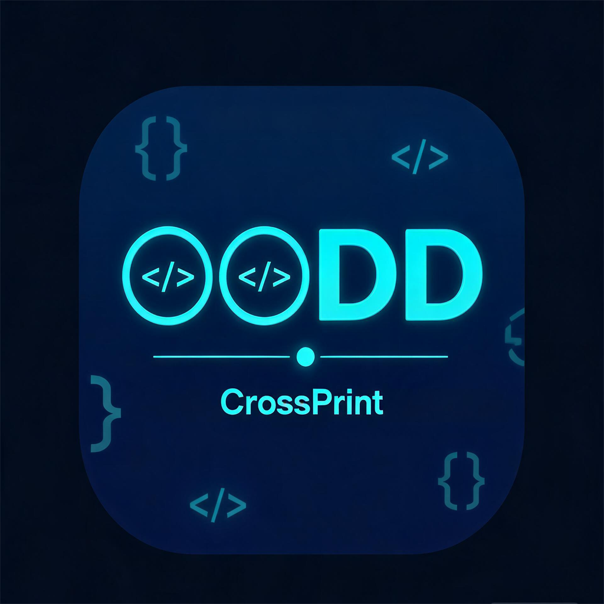
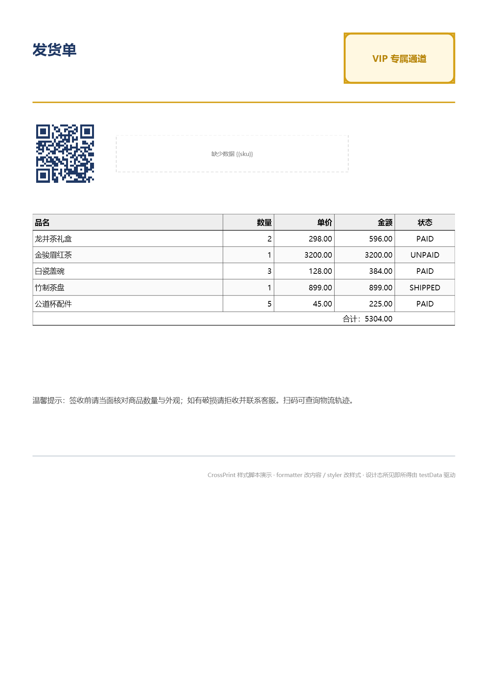
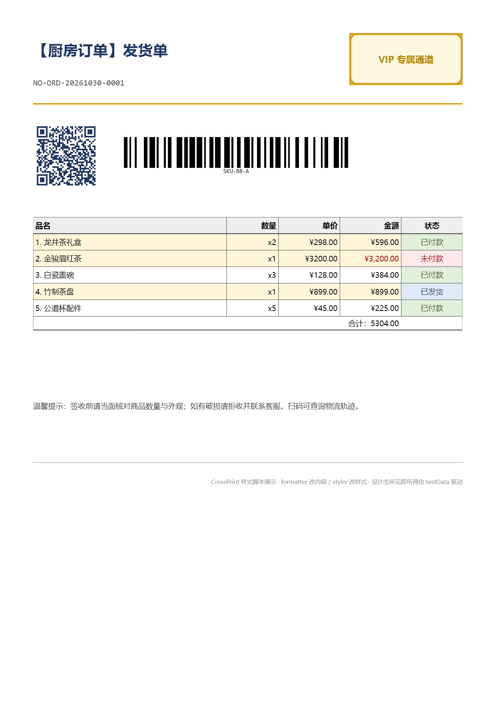

<p align="center">
  
</p>

# OODD CrossPrint

一个跨平台 .NET 打印模板组件。**你只需要写一份模板、接一份数据、点一下"打印"**——剩下的事交给它。Avalonia、WPF、WinForms、Eto.Forms、WinUI、Uno、.NET MAUI，全部七宿主共用同一个渲染内核：画布上看到什么样，导出的 PDF 就是什么样，送进打印机还是什么样。**所见即所得，不玩两套渲染。**

已经在用 hiprint（vue-plugin-hiprint / Vue-Print-Designer）设计器了？太好了——**它导出的模板直接吃**，不需要重新画一遍。

> 模板里写的全是毫米和磅，没有像素这个坑。引擎画每一个像素，宿主控件只负责"把画布放到屏幕上"——这俩互不干扰。

**中文** | [English](README.en.md) · [在线示例（WebAssembly，点了就能玩）](https://oodd-devnet.github.io/OODD.CrossPrint/)

---

## 先看一眼——设计器和打印长啥样

<p align="center">
  
  
</p>

左边是设计器（Avalonia 宿主，跑的是"厨房水槽"模板——八种元素全上，连脚本都写上了）。右边是同一个模板的打印预览。两个窗口走同一条渲染路径，所以你在左边拖一下元素，右边立刻跟着变——不是"大概类似"，是**像素级一致**。

想自己玩？上面的 **在线示例** 链接点进去就行，浏览器直接跑，啥都不用装。

---

## 快速开始——两条路选一条

### 路线 A：跑样例看看效果（推荐先玩这个）

需要 **.NET SDK 8.0 以上**。打开 PowerShell，cd 到仓库根目录，任选一行跑：

```powershell
# Avalonia 跨平台（Windows / Linux / macOS 都能跑，推荐）
dotnet run --project samples/CrossPrint.Samples.Avalonia

# 其他都是 Windows 专属
dotnet run --project samples/CrossPrint.Samples.Wpf
dotnet run --project samples/CrossPrint.Samples.WinForms
dotnet run --project samples/CrossPrint.Samples.Eto
dotnet run --project samples/CrossPrint.Samples.WinUi
dotnet run --project samples/CrossPrint.Samples.Uno
dotnet run --project samples/CrossPrint.Samples.Maui
```

样例自带两份模板：`kitchen-sink.template.json`（八种元素全覆盖）和 `hiprint-sample.js`（hiprint 模板）。打开后点 **文件 → 导入 hiprint 模板…** 把那份 `.js` 丢进去就能看到 hiprint 导入效果。

### 路线 B：NuGet 装进你自己的项目

先看看你用的是什么 UI 框架，挑对应的宿主包。CrossPrint 把内核（渲染、数据绑定、脚本、PDF）和宿主（把画布塞到 WPF/Avalonia 窗口里）彻底分开了——**内核包不依赖任何 UI 框架**，只有宿主包才依赖。

| 你在做什么 | 装这几个包就够了 |
|---|---|
| 任何宿主都需要的内核 | `CrossPrint.Core` · `CrossPrint.Engine` · `CrossPrint.Designer` · `CrossPrint.Printing` |
| Avalonia | `CrossPrint.Hosts.Avalonia` |
| WPF | `CrossPrint.Hosts.Wpf` |
| WinForms | `CrossPrint.Hosts.WinForms` |
| Eto.Forms | `CrossPrint.Hosts.Eto` |
| WinUI 3 | `CrossPrint.Hosts.WinUi` |
| Uno | `CrossPrint.Hosts.Uno` |
| .NET MAUI | `CrossPrint.Hosts.Maui` |

举个实际例子（Avalonia 宿主）：

```powershell
dotnet add package CrossPrint.Core
dotnet add package CrossPrint.Engine
dotnet add package CrossPrint.Hosts.Avalonia
```

然后代码里这样用：

```csharp
using CrossPrint.Core;
using CrossPrint.Hosts.Avalonia;

// 第一步：加载模板（JSON 字符串 / hiprint 文件都行）
var load = TemplateJson.Load(File.ReadAllText("template.json"),
                             TemplateJsonLoadOptions.Tolerant);

// 第二步：放一个设计画布——用户可以在上面拖元素改模板
var designer = new DesignerControl(load.Template)
{
    Data = new { orderNo = "SO-2026-0001", customer = "张三" },
};

// 或者放一个只读预览——给用户看效果但不让改
var preview = new PreviewControl(load.Template)
{
    Data = new { orderNo = "SO-2026-0001" },
};
```

导出 PDF：

```csharp
using CrossPrint.Engine;

using var stream = File.Create("销售单.pdf");
var report = PdfExporter.Export(
    designer.Kernel.Template,
    stream,
    data: designer.Data,
    renderer: designer.Renderer);

// report 里会告诉你有没有缺失字段、图片找不到、脚本报错——不会炸整页
if (report.HasIssues) Console.WriteLine(report);
```

送进打印机：

```csharp
using CrossPrint.Printing;

var document = new PrintDocument(designer.Kernel.Template, designer.Data);
var report = new RenderReport();

// 方式一：打印到 PDF 文件
await new PdfFilePrintTarget()
    .PrintBatchAsync([document], new PrintSettings { OutputPath = "销售单.pdf" }, report);

// 方式二：交给操作系统的打印对话框
await new SystemPrintTarget()
    .PrintBatchAsync([document], new SystemPrintOptions(), report);
```

---

## 设计器怎么用——傻瓜版

所有七个宿主的设计器长得几乎一模一样：

```
┌──────────────────────────────────────────────────────────┐
│ 菜单栏：文件（导入 hiprint / 模板 JSON / 打印 / PDF）        │
├──────────────────────────────────────────────────────────┤
│ 工具带一：文字 线段 矩形 椭圆 图片 二维码 一维码 表格        │
│ 工具带二：样式库 | 副本 删除 | 上移 下移 置顶 置底           │
│           | 适合窗口 100% | □网格 □标尺 □安全区              │
│           | 打印 导出 PDF 预览                              │
├────────┬───────────────────────────────┬─────────────────┤
│ 纸张    │                               │ 属性面板         │
│ 工具箱  │         设计画布               │ （选中元素后     │
│        │      滚轮缩放 / 中键平移）       │   自动生成表单） │
├────────┴───────────────────────────────┴─────────────────┤
│ ▸ 模板 JSON（默认折叠，点一下展开）                          │
├──────────────────────────────────────────────────────────┤
│ 状态栏（当前缩放、选中元素的位置尺寸、绑定字段）              │
└──────────────────────────────────────────────────────────┘
```

### 添加元素

- **方法一**：左边工具箱里选中一个元素类型，点「添加到画布」（或双击 / 回车），元素落在页面正中间。
- **方法二**：直接点工具带上那排图标——文字、线段、矩形、二维码……一键添加。
- **方法三**：Ctrl+D 复制一个已经画好的元素——这是最快的，特别是表格列。

### 改属性

选中一个元素，右边会自动生成对应的属性表单。不同元素类型表单不一样——文字元素有字号/颜色/对齐/换行；表格元素有二维表头编辑器、尾行汇总；图片元素有填充模式、圆角。**拖拽元素或缩放元素的时候不会拆掉你正在输入的那个文本框**——这是细节但很重要。

### 右键菜单（别忽视了）

选中元素右键：**副本（Ctrl+D）、删除、上移/下移/置顶/置底、水平/垂直居中、适合窗口、100%、旋转纸张、自定义纸张尺寸**。

### 模板 JSON 面板（底部那个可以展开的）

展开后你能看到整个模板的 JSON——改完点 **「应用 JSON」**（或 Ctrl+Enter）替换模板。**这个面板也能用来粘 hiprint 的 JSON**——把 hiprint 设计器里 `getJson()` 返回的那个 `{"panels":[…]}` 原样粘进去，点应用，CrossPrint 会自动识别出 hiprint 格式并转换。

### 快捷键（记不住也没关系，鼠标都能点）

| 按什么 | 干啥 |
|---|---|
| 方向键 | 1mm 微调（按住 Shift 变 10mm、按住 Ctrl 变 0.1mm） |
| Ctrl+D | 复制当前选中的元素 |
| Delete | 删掉 |
| Esc | 取消拖拽 / 清除选择 |
| F | 整页缩放到刚好塞满窗口 |
| 0 | 恢复 100% |
| Ctrl + 鼠标滚轮 | 缩放画布 |
| 鼠标中键拖动 | 平移画布（适合放大以后看细节） |
| Ctrl+Enter（在 JSON 面板里） | 应用你改完的 JSON |

---

## JS 脚本（formatter / styler）——能跑什么、不能跑什么、给你一堆例子

这是最常被问到的部分。先说结论：

> **能跑业务逻辑**：for/while/if/数组遍历/对象操作/正则表达式/闭包/递归/内置 Math、Date、JSON……JS 常规能力都有。**不能碰外部世界**：没有文件、没有网络、没有 DOM、没有 `console.log`、没有 C# 对象访问。这是一个纯沙箱。

CrossPrint 用 [Jint](https://github.com/sebastienros/jint)（纯 .NET 实现的 JS 引擎）跑这些脚本。**和 hiprint 的 formatter/styler 语义完全一致**——如果你在 hiprint 里已经写过这些脚本，粘过来直接跑，不用改。

### 两种脚本：formatter 和 styler

**formatter** —— 改显示内容。接收绑定字段的原始值，返回你想显示的字符串。

**styler** —— 改样式。根据绑定字段的值返回样式对象（可以是 JS 对象，也可以是 CSS 字符串），比如"金额超过 1000 的那格标红加粗"。

### 脚本签名（参数到底传了什么）

**元素级脚本**（文本、条码、二维码）：

```javascript
function(value, options, target, templateData) { ... }
```

| 参数 | 是什么 |
|---|---|
| `value` | 这个元素绑定的字段的原始值。比如你绑定了 `order.total`，那这里就是订单总金额的数字。 |
| `options` | `{ id: "el_123", type: "text" }` —— 元素自己的 id 和类型 |
| `target` | 和 options 一模一样（兼容 hiprint 的签名） |
| `templateData` | **整份打印数据**！可以点取 `templateData.customer.name`、`templateData.order.items`……想查啥查啥。 |

**表格列级脚本**（表格里每一列都可以有自己的 formatter/styler）：

```javascript
function(value, row, index, options, templateData) { ... }
```

比元素级多了两个——`row` 是当前行的完整对象（你可以点 `row.product.name`），`index` 是当前第几行（0 起）。

### 能用哪些 JS 特性

✅ **有**：变量、if/else、for/while/do、switch、数组（map/filter/reduce/find/slice/splice 全有）、对象、函数、箭头函数、闭包、递归、正则表达式、解构赋值、展开运算符、模板字符串、`Math.*`（floor/ceil/round/random/pow/sqrt/sin/cos…）、`Date`（但没法拿系统时间，只能用传入的数据构造）、`JSON.parse` / `JSON.stringify`

❌ **没有**：`fetch`、`XMLHttpRequest`、`fs`、`require`/`import`、`window`、`document`、`console`（hiprint 里本来也没有）、`setTimeout`/`setInterval`（打印是同步的，不允许异步）、`new Date()` 不带参数时不会给你当前时间、**任何 CLR（C#）类型的实例化或访问**——Jint 默认不开放 CLR 互操作

### 安全约束（这些不是 bug，是故意这样的）

| 约束 | 值 | 为什么 |
|---|---|---|
| 单次执行超时 | **250ms** | 打印不能因为一个死循环卡 10 秒 |
| 最大语句数 | **100,000** | 防止 `while(true){}` 绕开超时 |
| 最大递归深度 | **64 层** | 防止递归爆栈 |
| 脚本缓存 | **256 条 LRU** | 同一份脚本源码第二次执行不用重新解析 |

**超了会怎么样？** 什么都不会发生——脚本被跳过，元素显示原始值/默认样式，报告里记一条警告。**渲染永不中断**。你不会看到"脚本超时导致整页打印失败"这种鬼事。

### 一堆真实能用的脚本示例

好，看代码。

---

**示例 1：formatter——金额格式化**

```javascript
function(value) {
    if (value == null || value === '') return '¥0.00';
    // value 可能是数字也可能是字符串
    var n = typeof value === 'number' ? value : parseFloat(value);
    if (isNaN(n)) return String(value);
    return '¥' + n.toFixed(2).replace(/\B(?=(\d{3})+(?!\d))/g, ',');
}
// 输入: 1234567.8  → 输出: "¥1,234,567.80"
// 输入: null       → 输出: "¥0.00"
// 输入: "hello"    → 输出: "hello"（数字解析失败就原样返回）
```

---

**示例 2：formatter——日期格式化（绑定值是 ISO 字符串）**

```javascript
function(value) {
    if (!value) return '';
    var d = new Date(value);
    if (isNaN(d.getTime())) return String(value);
    var y = d.getFullYear();
    var m = String(d.getMonth() + 1).padStart(2, '0');
    var day = String(d.getDate()).padStart(2, '0');
    return y + '年' + m + '月' + day + '日';
}
// 输入: "2026-11-02T08:30:00Z"  → 输出: "2026年11月02日"
```

---

**示例 3：formatter——根据模板数据联动**

一个元素绑定了 `item.discount`（折扣，比如 0.15 代表 15%），想在文字里同时显示原价和折后价：

```javascript
function(discount, options, target, templateData) {
    // templateData.order.originalPrice 是原价
    var original = templateData.order.originalPrice || 0;
    var disc = typeof discount === 'number' ? discount : parseFloat(discount) || 0;
    var final = original * (1 - disc);
    return '原价 ¥' + original.toFixed(2) + ' → 折后 ¥' + final.toFixed(2);
}
// 显示: "原价 ¥100.00 → 折后 ¥85.00"
```

---

**示例 4：styler——金额超过 1000 的标红加粗**

```javascript
function(value) {
    var n = typeof value === 'number' ? value : parseFloat(value);
    if (!isNaN(n) && n > 1000) {
        return { color: '#c0392b', fontWeight: 'bold' };
    }
    // 返回 null / undefined / 空对象 → 不改变样式
    return null;
}
```

同一个 styler，也可以写成 CSS 字符串：

```javascript
function(value) {
    var n = typeof value === 'number' ? value : parseFloat(value);
    if (!isNaN(n) && n > 1000) {
        return 'color:#c0392b;font-weight:bold';
    }
    return '';
}
```

两种写法效果一样，挑你顺手的。

---

**示例 5：styler——状态徽章**

订单状态字段（'pending' / 'paid' / 'shipped' / 'cancelled'），想给每个状态不同的颜色：

```javascript
function(value) {
    var map = {
        'pending':   { color: '#856404', backgroundColor: '#fff3cd' },
        'paid':      { color: '#0f5132', backgroundColor: '#d1e7dd' },
        'shipped':   { color: '#084298', backgroundColor: '#cfe2ff' },
        'cancelled': { color: '#842029', backgroundColor: '#f8d7da', textDecoration: 'line-through' },
    };
    return map[value] || null;
}
```

---

**示例 6：表格列 formatter——序号列**

表格里加一列"序号"，不想让后端在数据里多塞一个字段：

```javascript
function(value, row, index) {
    return String(index + 1);
}
// value 是空的（因为这列没绑定字段），row 是当前行，index 从 0 开始
```

---

**示例 7：表格列 styler——第 3 行开始标灰**

```javascript
function(value, row, index) {
    if (index >= 2) {
        return { color: '#999999' };
    }
    return null;
}
```

---

**示例 8：formatter——条形码数字自校验（EAN-13）**

```javascript
function(value) {
    if (!value || value.length !== 13 || !/^\d+$/.test(value)) return value;
    // EAN-13 校验算法，算对了原样返回，算错了标红提示
    var sum = 0;
    for (var i = 0; i < 12; i++) {
        sum += (i % 2 === 0 ? 1 : 3) * parseInt(value[i], 10);
    }
    var check = (10 - (sum % 10)) % 10;
    if (check === parseInt(value[12], 10)) return value;
    return value + ' ⚠️';  // 校验位不对就加个警告符号
}
```

### styler 能返回哪些样式属性

JS 对象形态（camelCase）和 CSS 字符串形态（kebab-case）都能。完整列表：

| JS 对象键 | CSS 等价 | 例子 |
|---|---|---|
| `color` | `color` | `'#ff0000'` 或 `'red'` |
| `backgroundColor` | `background-color` | `'#f5f5f5'` |
| `fontSize` | `font-size` | `'12pt'` / `'16px'` / `'4.2mm'`（无单位按 px 算） |
| `fontWeight` | `font-weight` | `'bold'` / `'normal'` / `'700'`（≥700 就算粗体） |
| `fontStyle` | `font-style` | `'italic'` / `'normal'` |
| `textDecoration` | `text-decoration` | `'underline'` / `'line-through'` / `'none'`（可同时写 `'underline line-through'`） |
| `letterSpacing` | `letter-spacing` | `'2pt'` |
| `lineHeight` | `line-height` | `'1.5'`（无单位倍数） |
| `textAlign` | `text-align` | `'left'` / `'center'` / `'right'` / `'justify'` |
| `verticalAlign` | `vertical-align` | `'top'` / `'middle'` / `'bottom'` |
| `padding` | `padding` | `'2mm 4mm'`（简写，支持 1-4 个值） |
| `paddingLeft` / `Top` / `Right` / `Bottom` | `padding-*` | `'2mm'` |
| `borderColor` | `border-color` | `'#333'` |
| `borderWidth` | `border-width` | `'0.5mm'` |
| `borderStyle` | `border-style` | `'solid'` / `'dashed'` / `'dotted'` |

不认识的键会被静默忽略——和 CSS 容错一个口径，不会因为写了个 typo 就炸。

### 返回值约定

| 返回 | formatter 效果 | styler 效果 |
|---|---|---|
| 字符串 | 替换显示文本 | 解析为 CSS 样式 |
| JS 对象（styler） | —— | 解析为样式 |
| `null` / `undefined` | **保留原值** | **不改变样式** |
| 数字 / 布尔 | `String()` 后替换显示 | —— |
| 异常 | **保留原值 + 报告记警告** | **不改变样式 + 报告记警告** |

最后那个异常很重要——如果你的脚本语法写炸了或者跑起来抛异常，CrossPrint **不会**让整页变成空白，只会当这个脚本不存在，用原始值画出来，然后在渲染报告里写清楚是什么错了（`TypeError: value.toFixed is not a function` 这种）。你可以在设计器底部的状态栏看到这些警告。

---

## hiprint 模板导入——支持什么、不支持什么

先说最爽的部分：**90% 的 hiprint 模板丢进来直接用，不需要改**。几何（pt→mm 自动换算）、元素类型、数据绑定、formatter/styler 脚本、表格二维表头、条码、二维码——全支持。

下面说的是那剩下 10%。**不支持的能力不会被静默丢弃**——导入器会在结果里列一条问题清单，告诉你"这里原来有个水印，CrossPrint 画不出来"，绝对不会悄悄吃掉你花了一下午画的东西。

### 支持的 hiprint 元素和属性（完整清单）

| hiprint 元素类型 | CrossPrint 里变成什么 | 备注 |
|---|---|---|
| `text` / `longText` | TextElement | pt 自动转 mm；fontSize 转 pt；formatter/styler 脚本原样保留 |
| `hline` / `vline` | LineElement | borderWidth / borderStyle / borderColor 全支持 |
| `rect` / `oval` | RectangleElement / EllipseElement | border 统一样式（不支持分边线型）；backgroundColor 填充 |
| `image` | ImageElement | **只支持 base64 data URL**。外链 URL 需要宿主提供 `IImageResolver`，否则渲染成占位框 |
| `table` / `tableCustom`（旧版） | TableElement | 二维表头 colspan/rowspan 全部展开；扁平 fields 数组也能读；每列的 formatter/styler 脚本保留 |
| `barcode` | BarcodeElement | 10 种码制全覆盖：Code128、EAN-13、EAN-8、UPC-A、UPC-E、ITF、Codabar、Code39、Code93、MSI |
| `qrcode` | QrCodeElement | 四种纠错等级 L/M/Q/H；码下标题（caption）+ 对齐 + 字体 |
| `html` | RectangleElement（虚线框占位） | **不渲染 HTML**，画一个虚线灰色框告诉你这里原来有个 HTML 元素 |

### 支持的 hiprint 面板级属性

| hiprint 属性 | CrossPrint 处理方式 |
|---|---|
| `width` / `height` | 面板尺寸（mm），自动匹配预设纸张（A4 等）或标记为 Custom |
| `panelPageRule: "none"` | 标记为连续纸（高度 0，跟随内容长度） |
| `paperHeader` / `paperFooter` | 转换为可打印区留白（上下 margins） |
| `formatter` / `styler`（元素级） | 原样入库，渲染期由 Jint 执行 |
| `testData` | 收集为设计态预览数据，画布上绑定字段显示测试值 |
| `transform: "rotate(Ndeg)"` | 提取 N 作为元素旋转角度 |
| `zIndex` | 直接映射 |
| `qrCodeLevel` / `qrcodeLevel` | 0→L, 1→M, 2→Q, 3→H |
| `barcodeType` / `barcodeMode` | 10 种码制映射 |
| `borderRadius`（rect/oval） | 直接映射为圆角 |
| `textAlign` / `textContentVerticalAlign` | 映射为 HorizontalAlign / VerticalAlign |
| `textContentWrap` | nowrap/clip → 不换行；ellipsis → 不换行+省略号；其他 → 自动换行 |
| `contentPadding` / `contentPaddingLeft` … | 映射为 TextOptions 四个内边距 |
| `textDecoration` | underline / line-through 支持；overline **不支持** |
| `fit`（image） | contain / cover / fill / none 全支持；scale-down 按 contain 处理 |
| `columns`（table） | 二维表头展开；支持扁平数组 `[{title, field, width}]` |
| `fields`（table，旧写法） | 单行列定义 |
| `rowspan` / `colspan` | 直接展开到网格 |
| `tableSummary` / `tableSummaryTitle` / `tableSummaryText` / `tableSummaryNumFormat` / `tableSummaryColspan` | 全部支持，尾行汇总 |
| `checked: false` | 标记为隐藏列，导入时忽略 |
| `tableTextType` | 影响表头单元格文本处理（保持原样） |

### 不支持的 hiprint 能力（导入时会告警）

| hiprint 能力 | 会发生什么 | 严重级别 | 替代方案 |
|---|---|---|---|
| **水印** `watermarkOptions` | 忽略 | ⚠️ Warning | 用背景图（ImageElement 放最底层）或自定义绘制 |
| **页码** `paperNumber*` | 忽略 | ⚠️ Warning | 暂时没有。如果很多人需要我们可以加 |
| **面板打印偏移** `leftOffset/topOffset` | 忽略 | ⚠️ Warning | CrossPrint 不支持整张纸偏移 |
| **HTML 元素** | 变成虚线灰色占位框 | ⚠️ Warning | 改成文本 + 图片 + 表格组合 |
| **插件自定义元素** | 跳过（整张元素消失） | ⚠️ Warning | 用内置元素重画 |
| **长文本自动续页** `longText` | 裁切在元素框内，不会自动分页 | ⚠️ Warning | 暂时没有自动分页能力 |
| **日期/布尔格式化** `dataType` / `format` | 按原始值打印 | ⚠️ Warning | 用 formatter 脚本自己写格式化逻辑 |
| **中文金额大写** `upperCase` | 按原值打印 | ⚠️ Warning | 用 formatter 脚本自己转 |
| **强制分页** `pageBreak` | 忽略 | ⚠️ Warning | 暂时没有手动分页能力 |
| **按页选择性打印** `showInPage` / `unShowInPage` | 忽略 | ⚠️ Warning | —— |
| **每页重复打印** `fixed` | 只出现一次 | ⚠️ Warning | —— |
| **条形码固定模块宽** `barWidth` | 等比拉伸到元素宽度（扫描不受影响） | ℹ️ Info | —— |
| **图片外链 URL**（非 data:） | 需要宿主提供 IImageResolver，否则占位框 | ℹ️ Info | 要么转 base64 内嵌，要么实现 resolver |
| **表格级 formatter/styler** | 丢掉（只保留列级） | ℹ️ Info | 用列级脚本逐列处理 |
| **分组表头** `{title, columns:[...]}` | 展开子列，丢失分组标题 | ℹ️ Info | 单行表头没有分组概念 |
| **多面板模板** | 一次只导入一个面板（第 0 个） | ℹ️ Info | 用 `HiprintImportOptions.PanelIndex` 逐个导入 |
| **非 rotate 的 transform** | 忽略 | ℹ️ Info | 只支持 `rotate(Ndeg)` |
| **分边线型** `borderLeft` / `borderTop` … | 统一成一套描边 | ℹ️ Info | —— |
| **文本上划线** `textDecoration: overline` | 忽略 | ℹ️ Info | —— |
| **longTextIndent** | 忽略 | ℹ️ Info | —— |

### 导入器能吃什么格式

四种格式都行，不用挑：

1. **严格 JSON**——`{"panels":[{"width":210,"height":297,"printElements":[...]}]}`
2. **hiprint `getJson()` 输出**——`{"json":{"panels":[...]}}`（外面包了一层 `json` 键）
3. **JS 对象字面量**——`{ panels: [{ width: 210, printElements: [...] }] }`（没加引号的键也认）
4. **整个 `.js` 模块文件**——`export const json = {...}` 或 `module.exports = {...}` 都能扒出来

```csharp
using CrossPrint.Core.Hiprint;

var result = HiprintTemplateImporter.Import(File.ReadAllText("my-hiprint-template.js"));

var template = result.Template;                  // 交给设计器 / 渲染 / 打印
foreach (var issue in result.Issues)             // 遍历所有降级/忽略告警
    Console.WriteLine(issue);

// result.Panels 里是源模板所有面板的概要——如果有多个面板（多联单），
// 可以告诉用户选哪一个，然后用 PanelIndex 分别导入
```

---

## 模板格式——你自己写模板也可以

### 单位

**全部毫米**（`WidthMm`、`XMm`、`YMm`、`WidthMm`…），字体**全部磅**（`SizePt`）。**没有像素**，不需要管 DPI，不会出现"我在 96dpi 机器上画 100px 到 300dpi 打印出来不是一回事"这种坑。

### 数据绑定

文本元素里写 `{{order.customer.name}}`，运行时自动从数据对象里取值。表格写 `table.field: "items"` 就从 `data.items` 数组展开每一行。

数据源可以是：
- 任意 POCO（普通 C# 对象，属性/字段都认，大小写不敏感）
- `Dictionary<string, object?>`
- `System.Text.Json` 的 `JsonElement` / `JsonNode`

**绑定失败不抛异常**——值替换为空串，报告里记一条"字段 xxx 找不到"。

### 模板 JSON 最小示例

这是一个只有 A4 纸 + 一个文本元素 + 一个表格的最小模板：

```json
{
  "paper": { "preset": "A4", "widthMm": 210, "heightMm": 297, "orientation": 0 },
  "margins": { "topMm": 5, "bottomMm": 5, "leftMm": 5, "rightMm": 5 },
  "elements": [
    {
      "id": "title",
      "typeKey": "text",
      "xMm": 10, "yMm": 8, "widthMm": 80, "heightMm": 10,
      "text": { "content": "销售单 No.{{orderNo}}", "fontSizePt": 18, "bold": true }
    },
    {
      "id": "items",
      "typeKey": "table",
      "xMm": 10, "yMm": 25, "widthMm": 190, "heightMm": 80,
      "table": {
        "field": "items",
        "columns": [
          { "title": "序号", "formatter": "function(v,r,i){return i+1;}" },
          { "title": "商品", "field": "name" },
          { "title": "单价", "field": "price",
            "formatter": "function(v){return '¥'+(+v).toFixed(2);}",
            "styler": "function(v){return +v>1000?'color:#c0392b;font-weight:bold':null;}" },
          { "title": "数量", "field": "qty" },
          { "title": "小计", "formatter": "function(v,r){return '¥'+((+r.price)*(+r.qty)).toFixed(2);}" }
        ]
      }
    }
  ]
}
```

---

## 宿主支持（最低框架要求）

| 宿主 | 最低 .NET | 平台 | 备注 |
|---|---|---|---|
| Avalonia 11.3 | .NET 8 | Windows / Linux / macOS + Browser/WASM | **唯一能跑 WASM 的宿主** |
| WPF | .NET 8（Windows） | Windows | —— |
| WinForms | .NET 8（Windows） | Windows | —— |
| Eto.Forms 2.10 | .NET 8 | Windows（可移植到其他平台） | —— |
| WinUI 3（WindowsAppSDK 1.6） | .NET 8（Windows） | Windows | —— |
| Uno 5.6 | .NET 8 | Windows | Uno 6.x 要求 SkiaSharp 3.x + net9，暂不跟进 |
| .NET MAUI 8 | .NET 8 | Windows | —— |

**内核层不依赖任何 UI 框架**——所以你可以在 Linux/macOS 上只引用 `CrossPrint.Engine` + `CrossPrint.Printing`，跑无头渲染/生成 PDF 的后台服务。

---

## 在线示例怎么部署

Avalonia Browser 样例编译出来是**纯静态文件**（大约 40MB，第一次加载要等 .NET WASM 运行时加载完），扔到任何静态托管就行：

```powershell
dotnet workload install wasm-tools
dotnet publish samples/CrossPrint.Samples.Avalonia.Browser -c Release
# 产物在 samples/CrossPrint.Samples.Avalonia.Browser/bin/Release/net8.0-browser/publish/wwwroot
```

**子路径部署**（比如 GitHub Pages 的 `/OODD.CrossPrint/`）——仓库里已经在 `index.html` 设好 `<base href="./">` 了，不用你改。

仓库自带 GitHub Actions workflow（[`.github/workflows/pages-demo.yml`](.github/workflows/pages-demo.yml)），push 到 main 自动发布。

---

## 已知限制（最后再讲一遍，避免踩坑）

- **二维码静区**按 4 模块绘制。极少数扫码器特别严格的话可能有问题——但大部分手机扫没问题。
- **没有手动分页**——模板写多长就画多长，长过一张纸会被裁掉。如果业务需要多页打印，建议模板按页拆分（两份模板 = 两页）。
- **没有水印**——hiprint 的 `watermarkOptions` 画不出来。想加水印用背景图（ImageElement 放最底层，半透明）。
- **没有页码**——`paperNumberFormat` 这些属性 CrossPrint 不认识。等有人真正需要了再加。
- **WASM 版**没有文件对话框（浏览器安全沙箱），hiprint 导入走底部的模板 JSON 面板粘贴。
- **.NET Framework 4.x 不支持**——SkiaSharp 2.88.9 虽然能跑 net461，但 Jint 4.x 和 System.Text.Json 8.0 最低要求 net8.0。想支持老 .NET 需要全面降级依赖，工作量巨大且引入包版本分裂。最低 .NET 8.0。

---

## 文档

- [`docs/template-schema.md`](docs/template-schema.md) — 模板 JSON 完整字段表 + hiprint 每个属性怎么映射过来的
- [`docs/rendering-spec.md`](docs/rendering-spec.md) — 逐元素渲染规格（坐标计算、字偶距、表格行高……）
- [`docs/webassembly-demo.md`](docs/webassembly-demo.md) — WASM 样例构建部署的每一步
- [`docs/third-party-licenses.md`](docs/third-party-licenses.md) — 用了哪些第三方库、什么协议、链接

## 许可

Apache License 2.0。不引入 AGPL 或商业授权依赖。
